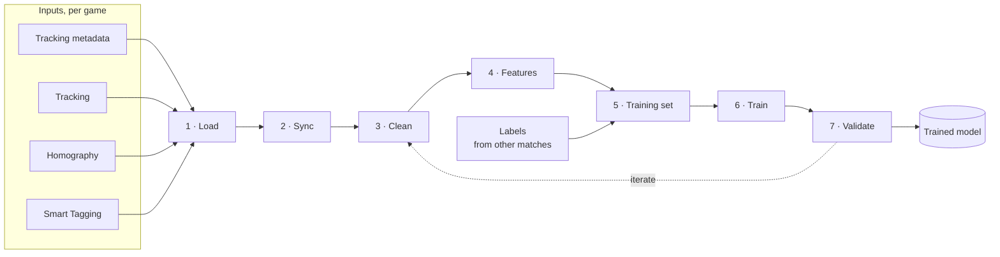

# Training pipeline

This document maps the stages and the decisions in each. It doesn't choose anything. For each
stage it lists:

- **Must do:** facts and rules from the repo. These aren't up for debate.
- **Choices:** the open questions, with the realistic options for each.

Stages 1–4 must run identically on the training games and on BAR-ATH. Stages 5–7 only ever see
games with labels you're allowed to train on, which BAR-ATH doesn't have.

**Why "labels from other matches"?** BAR-ATH does have 5 minutes of public labels, but
`RULES.md` (lines 77–79) says they are "for **checking that your pipeline is correct** … They are
not training data and not a tuning set". Labels for training must come from **other matches**,
which the rules allow in any amount ("External data about other games", "Hand-labelled data from
other games is fine"). The 5 minutes belong in the evaluation pipeline as a sanity check.

---

## Decisions that shape everything else

Answer these first. Most stage-level choices depend on them.

1. **Where do labels come from?** The rules allow other games only (see stage 5). Whatever source
   you pick also limits which inputs you can use, because a model can only use inputs the training
   games also have.
2. **Which inputs do you use?** Tracking only, or also Smart Tagging, homography, video, the
   broadcast feed.
3. **Do you train a model at all?** The alternatives are hand-written rules whose parameters are
   chosen on other games, or an unsupervised model fitted on BAR-ATH without labels. Both are
   allowed.
4. **What does the model predict?** One of H/A/D per frame, two separate questions (alive vs
   dead, then which team), or the change points themselves.

---

## 0 · Inputs

The match was filmed by a fixed **tactical camera**, a wide shot that shows most of the pitch.
Metrica's software then automatically produced four files from that video. None of them was
corrected by a person.

| file | what it is | time base | per frame? |
|---|---|---|---|
| `*_atd.xml` | tracking metadata: slot → team, pitch size, fps | none, static | no |
| `*_atd.txt` | tracking: 46 player slots (x, y, speed) + ball (x, y), normalised 0–1 | `frame_id`, **starts at 1** | yes, 199,319 records |
| `*_homography.csv` | 3×3 pitch→pixel matrix, `reprojection_error`, `valid` | `frame`, **starts at 0** | yes, 199,319 rows |
| `*_smart_tagging.xml` | 638 intervals: code + tags (Team, Type, Half, …) | **seconds** from the first video frame | no, intervals that overlap |

### Tracking metadata (`BAR-ATH_tactical_atd.xml`)

The **dictionary** for the tracking file. It holds no positions, only the information needed to
read them:

- **Track slots:** 46 entries named `Track 1` … `Track 46`, each assigned to **home or away**. Its
  "shirt number" is just the slot index, so this is the *only* source of team membership.
- **Pitch size:** 105 × 68 m in the file (`games.py` uses the measured 105.3 × 68.0), used to turn
  the 0–1 coordinates into metres.
- **Frame rate** (25 fps) and how each line of the tracking file is laid out.

**For possession:** without it you have positions but no teams. Read it once, then join it to
every frame by slot.

### Tracking (`BAR-ATH_tactical_atd.txt`)

The core data. **One text line per video frame**, 199,319 lines, each with:

- **46 player slots**, each with x, y (0–1 across the pitch) and speed (m/s), or `NaN` when that
  slot is empty on this frame. About 20 of the 46 are filled at any moment.
- **The ball:** x, y, or `NaN` when the tracker lost it, which happens on 41% of graded frames.

Line layout (from `starter/baseline.py`): `frame_id:slot1;slot2;…;slot46:ball`, each group being
`x,y,speed`.

Think of it as a **flip-book of dots**: per frame, ~20 coloured dots (teams) and sometimes a white
one (ball). Quirks: a slot isn't a person (it gets reused and swapped), there are occasional
duplicates, and the ball is missing exactly when play is crowded, fast or in the air.

**For possession:** almost everything comes from here: who is near the ball, how the teams are
shaped and how they move. Dead-ball moments show up as slow, re-organising players.

### Homography (`BAR-ATH_tactical_homography.csv`)

The **camera calibration**, one row per frame. A homography is a 3×3 matrix that converts a point
on the pitch (0–1 coordinates, same as the tracking) into the pixel where the camera shows it, and
back again.

- Columns: `frame`, `h00…h22` (the 9 matrix numbers), `reprojection_error` (how well the matrix
  fits; lower is better), `valid` (always 1 for the tactical file).
- Helpers: `starter/load_homography.py` has `project()` (pitch → pixel) and `unproject()`.

**For possession:** not useful on its own. It **connects tracking to the video**: to crop the
pixels around the ball or a player for a vision model, or to draw tracking onto frames while
debugging. `reprojection_error` also says when the camera view is unreliable (median 0.24 during
play, around 1.5 at halftime), which can serve as a confidence signal.

### Smart Tagging (`BAR-ATH_tactical_smart_tagging.xml`)

Metrica's **automatic tactical annotations**: 638 **time intervals**, each describing a phase of
play. It's a SportsCode XML file, the format analysts use to tag video. Each interval has:

- **start, end:** seconds from the first video frame, so `frame = round(seconds × 25)`.
- **code:** what kind of phase, e.g. `BUILD UP`, `PROGRESSION`, `ATTACKING TRANSITION`,
  `SET PIECES`, `BALL IN THE BOX`, `DEFENDING IN MIDDLE THIRD` (14 codes, listed in `DATA.md`).
- **tags:** `Team` (Barcelona / Atletic Club / **N/A**), `Half`, and for set pieces `Type`
  (throw-in, corner, goal kick, free kick, kick-off).

Intervals **overlap**: "Progression" and "Ball in final third" can run at the same time. They also
don't start or end exactly at possession changes.

**For possession:** a strong but imperfect hint. A phase tagged "Barcelona build-up" suggests home
possession, and every set piece marks a restart, meaning a dead ball just before. But it's
automatic, so expect mistakes. `Team` is `N/A` on all throw-ins, and intervals are phases rather
than possessions.

### Other files (optional)

- **Tactical video (`.mp4`):** what all four files above were made from. Row *i* = frame *i*.
  Useful for vision models or for watching problem moments.
- **Broadcast feed:** the TV video with its own tracking and homography, on its **own
  unsynchronised timeline** with cuts and replays. Using it means solving the alignment yourself.

### Other matches (training data)

Other matches **don't come as these four files.** Each dataset has its own format and usually only
some of the inputs:

| source | tracking metadata | tracking | homography | Smart Tagging | labels |
|---|---|---|---|---|---|
| **BAR-ATH** | ✓ | ✓ automatic, noisy | ✓ | ✓ | 5 min, **check only** |
| **IDSSE / Sportec** (7 matches) | ✓ (Sportec XML) | ✓ official, clean, real player IDs | ✗ none found | ✗ | ✓ per-frame alive/dead + team |
| **Metrica sample game 3** | ✓ **same EPTS format** | ✓ | ✗ | ✗ | from events, needs deriving |
| **Metrica sample games 1–2** | in the CSVs | ✓ CSV | ✗ | ✗ | from events, needs deriving |

So "same input format" really means **converting every source into one shared internal format** at
Load/Sync. `kloppy` does much of this: it reads Metrica EPTS and Sportec into the same structure,
and can convert both to the same coordinate system. What's left for us:

- **Coordinates and units:** pick one system (e.g. metres, origin, direction) and convert every
  source to it.
- **Player identity:** IDSSE has real player IDs. Drop them, or mimic slots, so training data looks
  like ours (team only, no identities).
- **Tracking quality:** IDSSE's ball is nearly always present and ours isn't. Close the gap by
  degrading the training data (stage 5).
- **Missing inputs:** homography and Smart Tagging don't exist for the training matches. Either the
  trained model doesn't use them, or they come in **outside** the trained model (e.g. tags as a
  prior in the decoder, or video features only where you can compute them for every game).

Background reading on approaches and datasets: [`__research.md`](__research.md).

---

## 1 · Load

Parse each file into memory.

**Must do**
- Raw tracking line format: `frame:player;player;…:ball`, each group `x,y,speed`, with `NaN` for
  anything missing (see `starter/baseline.py`).
- Get each slot's team from the XML (`baseline.team_of_each_track()` does this).
- Smart Tagging: codes are UPPER case, tag values are Title case. Match case-insensitively.
- Find files through `games.asset_paths()` / `MTAH_DATA_DIR`. Never hard-code a path.
- **Each data source needs its own loader that outputs one shared format.** Other matches don't
  come as the same four files (see "Other matches" under 0 · Inputs). From Load onwards, every
  game should look the same to the rest of the pipeline.

**Choices**

| decision | options |
|---|---|
| Tracking parser | kloppy (`metrica.load_tracking_epts`: convenient, but slow and memory-heavy over 199k frames) · own fast parser (like `baseline.py`) |
| Player layout | wide: 46 × (x, y, speed) columns per frame, mostly NaN · long: one row per (frame, slot) · both |
| Which sources | tracking only · + Smart Tagging · + homography · + video · + broadcast |

---

## 2 · Sync

Put everything on one shared frame number.

**Are the sources already synced?** For the tactical recording, almost. They all run on the same
video timeline but count in different units, so this stage is a conversion, not an alignment
search:

| source | to frame number |
|---|---|
| tracking | `frame = frame_id - 1` |
| homography | already `frame` |
| Smart Tagging | `start = round(start_s × 25)`, `end = round(end_s × 25)`, giving intervals |
| metadata | static, joined by slot, not by frame |
| ground truth / submission | row number = frame |
| broadcast | **not synced, no mapping given.** A real alignment problem if you use it |

**Must do**
- Check that each per-frame table has exactly 199,319 rows with frames `0…199318`.
- Know the graded halves: `games.half_video_blocks("BAR-ATH")` gives 11185–90651 and
  110808–190197. The 2nd half is graded from 110808 but kicks off at 113742, so those frames are
  all `D`.
- Training games will have their own time bases and need their own conversion here.

**Choices**

| decision | options |
|---|---|
| Tag intervals → per-frame columns | one on/off column per code · per code, the team that's tagged · "active phase" column (needs a rule for overlaps) · time to the nearest set piece · leave as intervals and use them later |
| Ungraded frames (pre-match, halftime, post) | keep (useful context, e.g. warm-up looks like dead ball) · drop · keep with a flag |
| Extra columns | `half`, `graded`, `seconds_into_half` · none |

---

## 3 · Clean

Fix or flag what the automatic tracking gets wrong.

**Must do (known problems)**
- The ball is missing on **41%** of graded frames, mostly at the moments that matter.
- Slots aren't people: they appear, vanish and switch identity. Expect ~20.5 tracked objects, and
  occasionally more than 22 because of duplicates.
- Coordinates are 0–1. The pitch is 105.3 × 68.0 m (`games.py`), so convert before measuring
  distances.
- Teams switch ends at halftime. Check how the coordinates handle that before using direction.
- Check whether any slots are referees or unknowns.

**Choices**

| decision | options |
|---|---|
| Units | metres · normalised 0–1 |
| Direction of play | raw · flip so each team always attacks the same way · flip relative to the team being described |
| Ball gaps | leave NaN · interpolate gaps up to N frames · Kalman / physics model · infer from players (e.g. the most crowded spot) |
| Ball outliers | none · speed/acceleration threshold · Kalman innovation test |
| Duplicate players | ignore · merge same-team slots closer than X m |
| Identity-switch spikes | ignore · mask speed near jumps · recompute speed from smoothed positions |
| Position smoothing | none · moving average · Savitzky–Golay · Kalman |
| Keep track of edits | overwrite · keep raw + cleaned + flag columns |

---

## 4 · Features

Turn cleaned frames into what the model reads.

**Must do**
- **Don't depend on slot order.** Slot 7 isn't a person, so describe teams collectively, or use a
  model that treats players as a set.
- Handle a missing ball explicitly. It's missing on nearly half the frames.
- Use the same code for training games and BAR-ATH.

**Choices**

| decision | options |
|---|---|
| Approach | hand-crafted features · learned from raw positions (set / graph / transformer models over players) · both |
| Feature families (if hand-crafted) | ball (speed, position, in/out of pitch, gap length) · ball–player (nearest per team, counts within r) · team shape (centroid, width, length, area) · movement (team / field speed) · tags · homography quality · video embeddings |
| Time context | single frame · past only · window centred on the frame (allowed, since this is offline) · several window sizes |
| Missing values | keep NaN (some models handle it) · fill + "missing" flag · learned embedding |
| Normalisation | none · per game · global |

---

## 5 · Training set

Pair features with labels.

**Must do (rules)**
- **No hand labels on BAR-ATH**, not even for training or validation. **No private ground truth.
  No human-made data about BAR-ATH** (event data, corrected tracking, annotations).
- **The public 5 minutes aren't training or tuning data.** Use them only to check the pipeline
  works.
- External data must be about other games, accessible to the organisers, and explained in the
  technical document.
- Labels should mean what the ground truth means: `D` = the corrected tracking marks the ball dead,
  otherwise the team the tracking names as owning it (`CHALLENGE.md`).

**Choices**

| decision | options |
|---|---|
| Label source | **IDSSE / Sportec open data** (7 Bundesliga matches, CC-BY 4.0): the tracking already marks every frame alive/dead and the team in possession, the same kind of label as our ground truth (see `__research.md`) · Metrica's public sample games (tracking + events, so labels must be derived from events; game 3 uses the same EPTS format as ours) · hand-label other games yourselves (allowed) · algorithmic pseudo-labels on BAR-ATH (allowed only if no person decides any of them) |
| Events → frame labels | e.g. team of the last controlled event; dead from "ball out" / foul to the next restart. Many variants, so decide how "controlled" is defined |
| Inputs the training games lack (e.g. Smart Tagging) | drop that input · train without it and add it later as a prior · find games that have it |
| Clean-vs-automatic gap (sample tracking is cleaner than ours) | ignore · degrade training data (drop the ball ~41%, add jitter, fake switches) · domain adaptation · unsupervised fitting on BAR-ATH |
| Sampling | every frame (highly correlated) · every N-th frame · balance classes (`D` vs live) |

---

## 6 · Train

**Must do**
- Reproducible: fixed seeds, pinned dependencies, config saved with the model. The repo must
  regenerate the exact submission.

**Choices**

| decision | options |
|---|---|
| Model family | rules with fitted thresholds · logistic regression · gradient boosting (LightGBM / XGBoost) · sequence model (1D-CNN / GRU / TCN / transformer) · HMM / CRF · unsupervised (mixture / HMM) |

The published models behind these options, and a suggested order to try them, are in [`__research.md`](__research.md).
| Output | 3-way H/A/D · two heads (alive/dead + team) · change-point detection |
| Loss / objective | per-frame cross-entropy · class-weighted · boundary-aware (extra weight near changes) |
| Hyperparameter search | none · grid · random / Bayesian (on training games only) |

---

## 7 · Validate

**Must do**
- **Split by game**, not by frame. Neighbouring frames are near-duplicates, so a random split
  inflates scores.
- Report the competition metrics with `evaluation/possession_metrics.py`. spellF1 needs clean
  segments, so validating it means running some decoder on the held-out predictions.

**Choices**

| decision | options |
|---|---|
| Split | leave-one-game-out · fixed train/val games · per half |
| What to watch | spellF1 + macroF1 · per-frame alive/dead F1 · team accuracy · possession count |
| Decoder parameters | tune here on held-out games · fix by hand · leave to the later evaluation stage |
| Iterate back to | cleaning · features · training set |

---

## Proposed conventions

These are suggestions to keep stages independent. Change them freely.

- **One key everywhere:** `frame` = video frame, 0-based, int32. Every per-frame table has one row
  per frame and never drops rows (missing = NaN), so tables join on `frame` without surprises.
- **One folder per game, one file per stage,** e.g.
  `<MTAH_DATA_DIR>/cache/<game>/{loaded,synced,clean,features}.parquet`. Intermediates are extracts
  of the data, so they live under the data directory, never in the repo (`CLAUDE.md`). Each stage
  reads only the previous stage's file.
- **Trained model folder:** `artifacts/<run_name>/`, containing the model file, the exact feature
  list, the config, and validation metrics.
- **Types:** float32 for measurements, bool for flags, categories for team and labels.
- **Data rule:** stage scripts print only summaries (counts, shapes, scores), never rows or
  coordinates. See `CLAUDE.md`.
